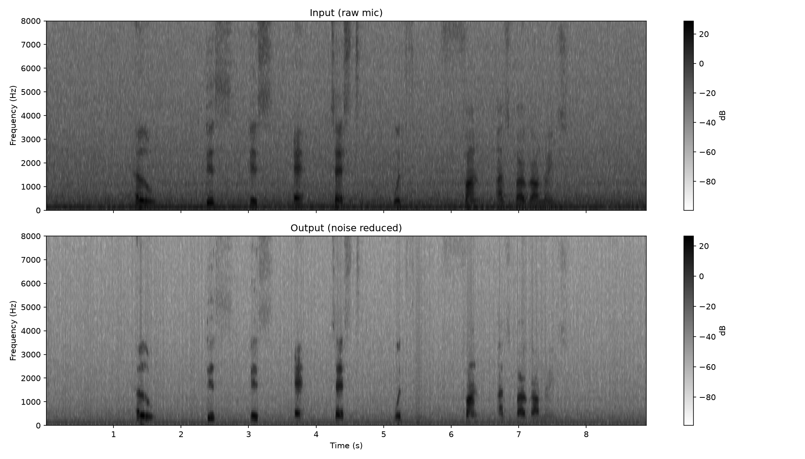
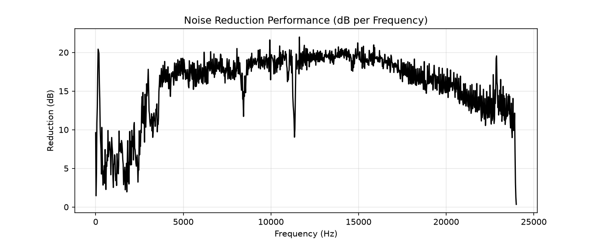
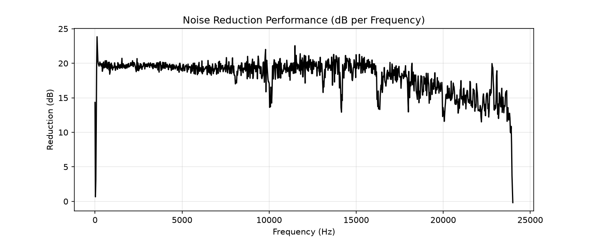
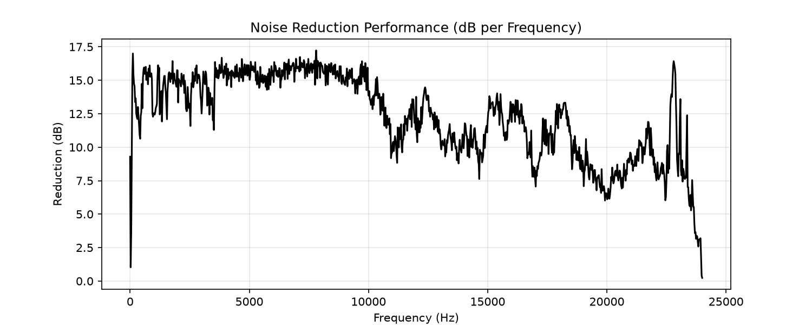

# Real-Time Noise Reducer: Technical Description

## 1. Scope

This document gives the signal path, parameters, and test results of the Real-Time Noise Reducer. The noise reducer is a JUCE audio plugin and standalone application. It uses spectral subtraction to decrease stationary background noise in a microphone signal.

---

## 2. Background

I first made the algorithm as a MATLAB prototype. The prototype uses the first 0.5 s of an audio file to calculate the noise spectrum. Then it subtracts that spectrum from the full file. 
A real-time plugin cannot read the full file before it starts. Thus, the C++ version calculates the noise spectrum during operation. A voice activity detector (VAD) stops the update when speech occurs.

I used an AI assistant as a pair programmer during the debug work.

---

## 3. Signal Path

### 3.1 Block Size Isolation

The host sends audio in blocks of different sizes. The algorithm needs frames of exactly 512 samples. Two circular buffers in `PluginProcessor.cpp` isolate the two sizes:

1. The processor writes each input sample into a 512-sample input buffer (`inputFifo`).
2. After each 256 samples, the processor copies the last 512 samples into a frame.
3. The processor sends the frame to `NoiseReducer::processFrame()`.
4. The processor puts the 256 output samples into a 512-sample output buffer (`outputFifo`).
5. The host reads its output samples from the output buffer.

### 3.2 Frame Analysis

| Item | Value |
| :--- | :--- |
| FFT size | 512 samples |
| Hop size | 256 samples (50% overlap) |
| Window | Hann, JUCE `WindowingFunction` with default normalization |
| Window position | Before the forward FFT only (no synthesis window) |
| Bins that the algorithm changes | 1 to 255 |
| Bin width | 93.75 Hz at 48 kHz |

In this document, M(k) is the input magnitude in bin k.

### 3.3 Voice Activity Detection

For each frame, the VAD calculates the frame energy E. E is the sum of M(k)² for bins 1 to 255. The VAD then puts the frame into one of three classes:

1. **Digital silence:** If E < 0.0001, the frame is silent. The VAD does not count the frame. The noise estimates do not change.
2. **Noise estimate period:** The first 20 frames that are not silent are noise frames. For these frames, the noise energy N_E = 0.5 × N_E + 0.5 × E. The first frame sets N_E = E.
3. **Normal operation:** After 20 frames, a frame contains speech if E > 2.0 × N_E. If the frame does not contain speech, N_E = 0.95 × N_E + 0.05 × E.

The VAD makes one decision for the full frame. It does not select frequency bands.

The noise estimate period is 20 × 256 = 5120 samples. This is approximately 0.11 s at 48 kHz.

### 3.4 Noise Spectrum Estimate

The code keeps one noise magnitude value, N(k), for each bin. N(k) changes only in frames that are not silent and do not contain speech. In speech frames, N(k) does not change.

| Condition | Update rule |
| :--- | :--- |
| First noise frame | N(k) = M(k) |
| Noise frames 2 to 20 | N(k) = 0.5 × N(k) + 0.5 × M(k) |
| After frame 20, M(k) > N(k) | N(k) = 0.90 × N(k) + 0.10 × M(k) |
| After frame 20, M(k) ≤ N(k) | N(k) = 0.995 × N(k) + 0.005 × M(k) |

The last two rules make the estimate increase quickly and decrease slowly. A local flag, `isLearningFrame`, selects the rule set. The VAD sets this flag only for frames in the noise estimate period.

### 3.5 Spectral Subtraction

For each bin, the code calculates the clean magnitude S(k):

```
S(k) = max( M(k) − α × N(k),  β × M(k) )
```

The code keeps the phase of the input bin. It writes the complex conjugate into the mirror bin (512 − k). Thus, the inverse FFT gives a real signal.

The β term sets a lower limit relative to the input magnitude of that bin. It is not a fixed noise level. The maximum decrease in one bin is 20 × log10(1/β). This is 40 dB at β = 0.01 and 6 dB at β = 0.50.

The code does not change the DC bin (0) or the Nyquist bin (256).

### 3.6 Reconstruction

1. Inverse FFT. JUCE scales the inverse FFT by 1/512.
2. The 512 output samples are then added into an overlap-add buffer.
3. The first 256 samples of the buffer are multiplied by 0.5 and sent to the output.
4. The buffer contents are nmoved 256 samples to the left.
5. The last 256 samples of the buffer are set to zero.

The 0.5 factor is necessary because the JUCE Hann window has normalization. With normalization, the mean window value is 1.0 and the peak value is approximately 2.0. Two such windows at 50% overlap add to approximately 2.0. A Hann window without normalization adds to 1.0.

---

## 4. Parameters

| Parameter | Symbol | In UI | Range | Default | Function |
| :--- | :--- | :--- | :--- | :--- | :--- |
| Subtraction Strength | α | Yes | 0.0 to 9.0, step 0.1 | 2.0 | Multiplies N(k) before subtraction. A high value removes more noise but causes more musical noise. |
| Spectral Floor | β | Yes | 0.01 to 0.50, step 0.01 | 0.01 | Sets the minimum output magnitude as a fraction of M(k). |
| VAD threshold | — | No | Fixed | 2.0 | Energy ratio that identifies a speech frame. |
| Digital silence threshold | — | No | Fixed | 0.0001 | Frames below this energy do not change the estimates. |
| Noise estimate period | — | No | Fixed | 20 frames | Number of frames for the first noise estimate. |

α and β are not host parameters. The host cannot automate them. The plugin does not save them with a session.

---

## 5. Latency

The total latency is 512 samples. This is 10.7 ms at 48 kHz and 11.6 ms at 44.1 kHz.

The test files in `resources/` confirm this value. The output aligns with the input at a delay of 512 samples.

The plugin does not report this latency to the host. Refer to Section 10.1.

---

## 6. Channel Configuration

The plugin accepts mono and stereo buses. The noise reducer operates only on the left input channel. In stereo, the code copies the result to the left and right outputs. The code does not use the right input channel.

---

## 7. Test Recorder

The editor has a **Start Recording** button. When you push the button, the plugin writes two 16-bit mono WAV files:

- `input_raw.wav`: the left input channel before noise reduction.
- `output_processed.wav`: the left output channel after noise reduction.

The file paths are fixed in the code (`C:/EXTRAS/Projects/JUCENoiseReduction/NewProject/resources/`). The recorder also writes diagnostic text files to fixed paths. On a different computer, these folders usually do not exist. Then the recorder does not start.

---

## 8. Development Notes

### 8.1 Digital Silence at Startup

**Symptom:** The noise estimates stayed at 0.0.

**Cause:** At startup, the microphone sent digital silence for a short time. The VAD used these silent frames for the 20-frame noise estimate. Thus, N_E and N(k) became 0.0. With N_E = 0.0, the VAD identified each subsequent frame as speech. Thus, the estimates did not update again.

**Correction:** I added the digital silence threshold (Section 3.3). Frames with E < 0.0001 do not count toward the 20 frames.

### 8.2 Output Gain

**Symptom:** An added 1/512 scale factor after the inverse FFT decreased the output level by approximately 54 dB. Without that factor, the output level was two times the input level.

**Cause:** The JUCE inverse FFT already scales by 1/512. Thus, the added factor applied the scale two times (20 × log10(1/512) = −54.2 dB). The gain of 2.0 comes from the normalized Hann window at 50% overlap (Section 3.6).

**Correction:** I removed the added 1/512 factor. I multiplied the overlap-add output by 0.5.

### 8.3 Asymmetric Noise Update

**Symptom:** After the noise estimate period, the asymmetric update rules (Section 3.4) did not operate. N(k) continued to use the 0.5/0.5 rule.

**Cause:** `frameCount` stops at 20. Thus, the test `if (frameCount <= 20)` was always true after the noise estimate period.

**Correction:** I added the local flag `isLearningFrame`. The VAD sets the flag only in the noise estimate branch. The noise update uses this flag in place of the `frameCount` test.

---

## 9. Test Results

### 9.1 Method

I recorded speech with background noise through the plugin at 48 kHz. Then `resources/plot.py` made two plots from each pair of files:

- A spectrogram of the input and the output (512-point FFT, 256-sample hop, 0 to 8 kHz).
- The average input power divided by the average output power, in dB, at each frequency.

The second plot shows the decrease in total signal power. This total includes speech and noise. It is not a signal-to-noise ratio (SNR) measurement.

The α and β values for these tests are not in the repository.

> **NOTE:** I made all tests in this section before the correction in Section 8.3. In these tests, N(k) used the 0.5/0.5 rule after the noise estimate period. With the correction, the results can be different.

### 9.2 Fan Noise



> _Figure 1: Fan noise with speech. Top: input. Bottom: output. The output keeps the speech harmonics below approximately 4 kHz. The noise level between words decreases._



> _Figure 2: Power decrease at each frequency, fan noise._

From 4 kHz to 20 kHz, the decrease is 15 to 20 dB. Below 3.5 kHz, the decrease is 3 to 10 dB. A narrow peak near 200 Hz reaches approximately 20 dB.

Most speech energy is below 4 kHz. In speech bins, M(k) is much larger than α × N(k). Thus, the subtraction removes a smaller fraction of the power in that band. The VAD does not cause this result, because the VAD does not select frequency bands.

### 9.3 White Noise



> _Figure 3: Power decrease at each frequency, white noise._

From 200 Hz to 16 kHz, the decrease is approximately 19 to 20 dB. From 16 kHz to 23 kHz, the decrease is 12 to 18 dB. White noise has equal power at all frequencies. Thus, the result is almost flat.

### 9.4 City Noise



> _Figure 4: Power decrease at each frequency, city noise._

Below 10 kHz, the decrease is 12 to 17 dB. From 10 kHz to 23 kHz, the decrease is 6 to 14 dB. City noise is not stationary. The noise reducer is not designed for this type of noise (Section 10.4).

The spectrograms for white noise and city noise are in `images/`.

### 9.5 Measurements from the Repository Test Files

The repository contains one pair of test files: `resources/input_raw.wav` and `resources/output_processed.wav` (48 kHz, 10 s). 

For this measurement, the output was aligned with the input (512-sample delay). The frames were then put into two groups by frame energy. This separation is approximate.

| Band | Decrease, quietest 30% of frames (noise) | Decrease, loudest 10% of frames (speech) |
| :--- | :--- | :--- |
| 0 to 300 Hz | 9.5 dB | 10.2 dB |
| 300 Hz to 3 kHz | 16.3 dB | 9.7 dB |
| 3 kHz to 8 kHz | 16.2 dB | 11.2 dB |
| 8 kHz to 16 kHz | 16.4 dB | 4.6 dB |
| 16 kHz to 24 kHz | 15.5 dB | 4.2 dB |

In the 300 Hz to 3 kHz band, noise frames decrease by 16.3 dB and speech frames decrease by 9.7 dB. Thus, the noise reducer removes more power from noise than from speech.

---

## 10. Known Issues and Limitations

### 10.1 The Plugin Does Not Report Latency

The plugin does not call `setLatencySamples()`. Thus, a DAW does not correct the 512-sample delay.

### 10.2 Build Targets

The project enables VST3, AU, and Standalone. The `.jucer` file contains only a Visual Studio 2022 exporter. To build the AU version, add an Xcode exporter.


### 10.3 Algorithm Limitations

- **Stationary noise:** The noise reducer is best for constant noise, for example fans and air conditioners. It decreases noise that changes quickly less.
- **Musical noise:** High α values cause short, unwanted tones in the output.
- **Quiet speech:** The VAD uses one energy value for each frame. Speech with E < 2.0 × N_E goes into the noise estimate.
- **Noise decrease:** When the background noise becomes quieter, N(k) decreases slowly (0.995 rule). The time constant is approximately 200 noise frames, or 1.1 s at 48 kHz. During this time, the noise reducer can remove too much signal.
- **Startup:** The noise reducer needs approximately 0.11 s of room noise without speech after startup. Digital silence does not count. If speech occurs in this period, the noise estimate includes speech.

---

**Author:** Van-Dyck Adanuty
